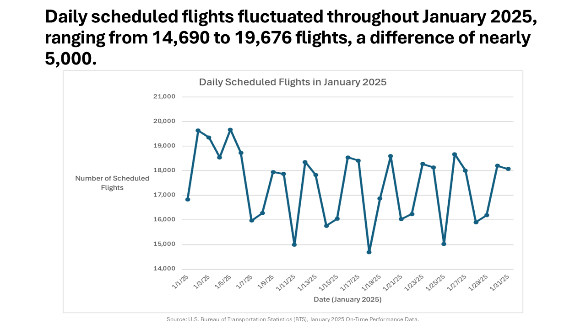
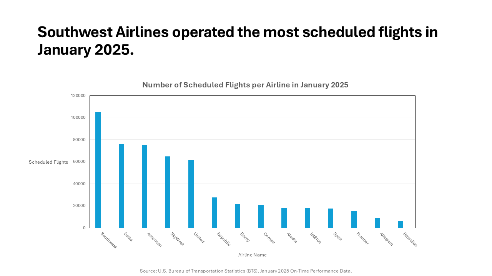
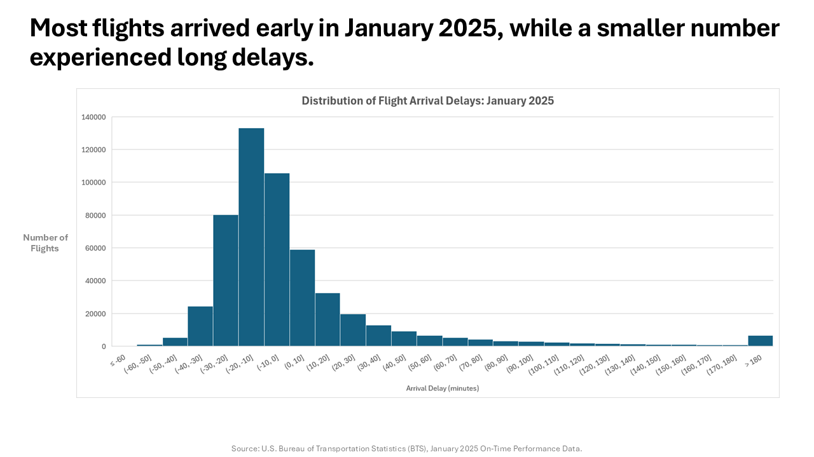
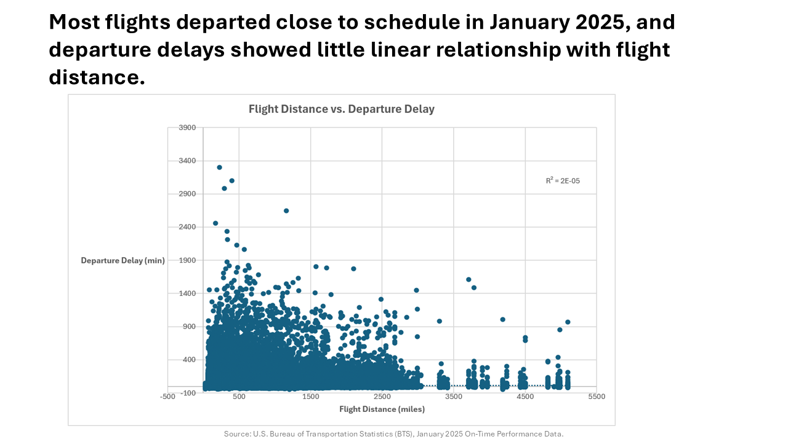

---

title: "U.S. Aviation: Flight Activity and Delays"

format: html

---

## Team Members

- [Peyton Meierhoff](https://peytonm2007.github.io/)

- [Trevor Miller](https://tmiller2178.github.io/)

- [Mark Tudor](https://markt-07.github.io/)

- [Samuel Otterburg Franco](https://samuelotterburg.github.io/)

- [Krutarth Prajapati](https://example.com)

## Dataset Description

Our team analyzed commercial aviation data from the U.S. Bureau of Transportation Statistics (BTS). The dataset contains 539,747 scheduled flight records from January 2025, including flight dates, airlines, departure delays, arrival delays, cancellations, flight times, and flight distances.

We used Microsoft Excel to analyze daily flight activity, compare airline operations, and examine patterns in flight delays.

## Question 1: Daily Scheduled Flights

### Research Question

How does the number of scheduled flights change from day to day throughout January 2025?

### Why This Question Is Interesting

Daily flight activity can reveal patterns in airline schedules and travel demand. Understanding these changes helps us see how flight volume varies throughout the month.

### Excel Analysis

We used Microsoft Excel to create a PivotTable that counted scheduled flight records for each day in January 2025, including cancelled flights. We then created a line chart to visualize the daily changes.

### Results and Visualization

Daily scheduled flights fluctuated throughout January 2025, ranging from 14,690 to 19,676 flights, a difference of nearly 5,000.

### Slide Development

We created an assertion-evidence slide in PowerPoint using our Excel line chart. The slide features a conclusion-based headline and a labeled graph showing daily flight activity.

## Question 2: Scheduled Flights by Airline

### Research Question

Which airlines operated the most scheduled flights during January 2025?

### Why This Question Is Interesting

Comparing scheduled flights across airlines helps us understand the relative scale of airline operations.

### Excel Analysis

We used Microsoft Excel to count scheduled flight records for each airline and created a bar chart to compare the results.

### Results and Visualization

Southwest Airlines operated the most scheduled flights in January 2025, showing the highest flight volume among the reporting airlines.

### Slide Development

We created an assertion-evidence slide using the Excel bar chart. The slide highlights the airline with the most scheduled flights and compares flight activity across carriers.

## Question 3: Arrival Delay Distribution

### Research Question

What is the distribution of arrival delays among flights in January 2025?

### Why This Question Is Interesting

Understanding arrival delays helps us see how frequently flights arrive early, on time, or late, and whether extreme delays are common.

### Excel Analysis

We used Microsoft Excel to group arrival delay values into intervals and created a histogram to visualize their frequency. Flights with missing arrival delay values were excluded from the analysis.

### Results and Visualization

Most flights arrived early or experienced relatively small delays, while a smaller number experienced significantly longer delays.

### Slide Development

We created an assertion-evidence slide using the Excel histogram. The slide highlights the concentration of flights around smaller delays and shows how the frequency decreases as delays become longer.

## Question 4: Flight Distance vs. Departure Delay

### Research Question

Is flight distance associated with how late a flight departs?

### Why This Question Is Interesting

We wanted to investigate whether longer flights experience different departure delays compared to shorter flights. Understanding this relationship can help us identify possible patterns in airline operations.

### Excel Analysis

We used Microsoft Excel to create a scatter plot comparing flight distance (miles) with departure delay (minutes). Records with missing values were excluded, while negative delays were retained because they represent early departures.

### Results and Visualization

The scatter plot allows us to examine whether flight distance and departure delays are related. The overall relationship is evaluated by looking at the distribution and pattern of the data points.

### Slide Development

We created an assertion-evidence slide in PowerPoint using the Excel scatter plot. The graph displays flight distance on the horizontal axis and departure delay on the vertical axis, allowing us to visually assess the relationship between the two variables.

